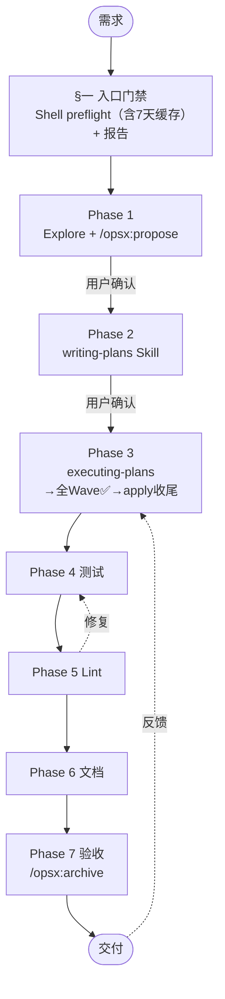

# Dev-Lifecycle 使用指南

> **Agent 规则权威**：[SKILL.md](SKILL.md)（入口门禁、阶段流转、禁止项）
> **本文件**：面向人的流程说明与快速参考，章节结构与 SKILL 对齐。

### 文档导航（对应 SKILL）

| README | SKILL | 内容 |
|--------|-------|------|
| [§二](#二skill-互斥与强制工具) | §〇 | 强制 OpenSpec/Superpowers 工具、brainstorming 互斥 |
| [§三](#三入口门禁) | §一 | Shell preflight、禁止项、环境 AskUserQuestion |
| [§四](#四全流程) | §三 | 7 Phase 总览与流转 |
| [§五](#五场景与使用) | §二、§五 | 场景判定、常见说法 |
| [§六](#六产物与时间) | §四 | dev-plan、时间戳、任务编号 |
| [§七](#七参考与脚本) | §六 | 目录结构、脚本、分层加载 |

---

## 安装

```bash
# 1) 安装 Skill 本体（会让你选 skill 与目标 IDE）
npx skills add <owner>/<repo> --skill dev-lifecycle -a claude-code -g

# 2) 环境依赖（也可留给 Skill 运行时 preflight 检测后按提示安装）
npm install -g @fission-ai/openspec@latest
npx skills add obra/superpowers --skill writing-plans --skill executing-plans -a claude-code -g
```

`-a` 可选 `claude-code` | `cursor` | `codex`。Skill 运行时会自己探测 agent，
探测不准时用 `--agent=<id>` 或环境变量 `DEVLC_AGENT` 覆盖。


## 一、是什么

将软件开发标准化为 **7 Phase + 前置准备**，通过 **dev-plan 索引 + 超链接** 串联两套权威产物：

| 层级 | 位置 | 职责 |
|------|------|------|
| dev-plan 索引 | `dev-plan/<plan-dir>/` | 流程追踪、阶段产物 |
| OpenSpec | `openspec/changes/` → `archive/` | proposal / design / tasks / specs |
| Superpowers TDD | `docs/superpowers/plans/*-tdd.md` | Wave 化实施计划 |

---

## 二、Skill 互斥

命中 dev-lifecycle 时，**禁止** `brainstorming`；Explore/Propose/Apply/Archive **必须** OpenSpec 工具；TDD **必须** Superpowers `writing-plans` / `executing-plans`（见 [mandatory-tooling.md](reference/mandatory-tooling.md)）。

| 用户说 | 实际路径 | 禁止 |
|--------|----------|------|
| 制定开发计划 / 出方案 | 门禁 → Phase 1（OpenSpec）→ Phase 2（writing-plans） | `brainstorming`、手写 openspec/TDD |
| 新功能 XXX | `/opsx:explore` → **对话正文 §2.1** → AskUserQuestion → `/opsx:propose` | `brainstorming`、跳过 §2.1 对话正文 |
| 开始开发 / 写代码 | Phase 3：**先** executing-plans → 全 Wave ✅  → **再** apply 收尾 | Phase 3 入口直接 apply；未过 Phase 2 时 writing-plans |

完整规则见 [SKILL.md §〇](SKILL.md#〇skill-互斥与强制工具)。

---

## 三、入口门禁

**第一个工具调用必须是 Shell**（先于任何项目 Read、禁止 `cd &&` 拼接）。
preflight **内置门禁时间戳缓存**：`.dev-lifecycle/.preflight-last-run` 距今 ≤ 7 天 → 输出 `gate-cache: valid` 直接跳过全量门禁（标记仅门禁通过时写入，存在且未超期即通过）；超期 / 缺失 / 不可解析 → 自动全量执行，通过后刷新时间戳，并重新校验 project-config。

```powershell
powershell.exe -NoProfile -ExecutionPolicy Bypass -File "<skill_root>\scripts\preflight.ps1"
# 强制重跑（忽略缓存）：追加 -Force
```

```bash
bash <skill_root>/scripts/preflight.sh
# 强制重跑（忽略缓存）：追加 --force
```

详细步骤：[phases/preparation.md](phases/preparation.md) · 报告模板：[templates/00-pre-flight-check-report.md](templates/00-pre-flight-check-report.md)

**环境就绪条件**

| 组件 | 判定 |
|------|------|
| Rules | 三 `.mdc`（01/02/03）为 True（preflight 内自动从 `reference/` 复制） |
| OpenSpec CLI | `openspec-cli-installed: True` |
| OpenSpec 目录 | 路径 `openspec` 为 True（缺失时 preflight 自动 init） |
| OpenSpec list | `openspec-list-ok: True` |
| OpenSpec 汇总 | `openspec-ready: True` |
| Superpowers | `superpowers_ready: True` + Reload 后 `writing-plans`、`executing-plans` Skill |

**环境 ❌ 时**：仅环境 AskUserQuestion（#1a / #1b / #2），**禁止** Phase 续航提问，**禁止** brainstorming。

---

## 四、全流程



**各 Phase 速查**

| Phase | 命令/Skill | 规则 | 产物 |
|-------|-----------|------|------|
| 前置 | Shell preflight | [preparation.md](phases/preparation.md) | 环境就绪 |
| 1 | `/opsx:explore` + `/opsx:propose` | [phase1.md](phases/phase1.md) | `1.proposal.md` + `openspec/changes/` |
| 2 | **`writing-plans`** Skill | [phase2.md](phases/phase2.md) | `2.plan.md` + TDD 计划 |
| 3 | **`executing-plans`** → 全 Wave ✅ → **`/opsx:apply`**（剩余 tasks） | [phase3.md](phases/phase3.md) | `3.dev.md` + 代码 |
| 4 | — | [phase4.md](phases/phase4.md) | `4.test-case.md` |
| 5 | run-lint 脚本 | [phase5.md](phases/phase5.md) | `5.lint-report.md` |
| 6 | AskUserQuestion | [phase6.md](phases/phase6.md) | `6.docs-update.md` |
| 7 | `/opsx:archive` | [phase7.md](phases/phase7.md) | `7.acceptance.md` |

**阶段流转**

| 从 | 到 | 条件 |
|----|-----|------|
| 开始 | Phase 1 | 门禁通过 + 计划目录已建 |
| Phase 1 | 2 | 质量门禁 + **用户确认** |
| Phase 2 | 3 | 质量门禁 + **用户确认** |
| Phase 3 | 4 | 全 Wave ✅（executing-plans）→ apply 收尾（可跳过若无剩余 tasks） |
| Phase 4 | 5 | 测试通过或用户确认跳过 |
| Phase 5 | 6 | Lint 零错误 |
| Phase 6 | 7 | 文档完成 |
| Phase 7 | 完成 | 验收 + archive |
| Phase 7 | 3 | 验收后反馈 |
| Phase 5 | 4 | Lint 修复后强制回退 |

---

## 五、场景与使用

> 本节对应 SKILL §二（门禁通过后）与 §五（快速启动）。

**场景判定**

| 条件 | 场景 | 动作 |
|------|------|------|
| 有 `7.acceptance.md` | A：验收后反馈 | 回退 Phase 3 |
| 有历史产物 | B/C/D… | 从下一阶段继续 |
| 未引用计划目录 | E：新需求 | 从 Phase 1 开始 |

**常见说法**

| 场景 | 说法示例 |
|------|---------|
| 完整流程 | 「帮我开发用户管理 CRUD」 |
| 制定开发计划 | 「制定开发计划，开发 XXX」（= Phase 1 → 确认 → Phase 2，**不是** brainstorming） |
| 已有 OpenSpec | 「按 openspec/changes/xxx/ 继续，生成 TDD 计划」 |
| 紧急修复 | 「修复登录提交无响应」（轻量条件可跳过 Phase 1/2） |
| 单阶段 | 「对 dev-plan/.../ 做 Lint」 |

**新功能逐步清单**

```
1. Shell preflight（内置 7 天缓存）→ 门禁报告
2. 环境 ❌ → 仅环境 AskUserQuestion；停止
3. 门禁「可以」→ exploration.md → project-config
4. 创建计划目录
5. Phase 1：调研 → **对话正文 §2.1（1）–（6）** → AskUserQuestion 选定 → /opsx:propose
6. 确认 Phase 1 → Phase 2 writing-plans
7. Phase 3 ~ 7
```

---

## 六、产物与时间

```
dev-plan/<YYYYMM>/<YYYYMMDD>/<YYYYMMDDHHmmss>_<type>_<detail>/
├── 1.proposal.md … 7.acceptance.md
└── lint-results/

openspec/changes/<name>/     → archive/<date>-<name>/
docs/superpowers/plans/YYYY-MM-DD-<feature>-tdd.md
```

**初始化**（时间戳须 Shell 获取）

```powershell
& <skill_root>/scripts/init-plan-dir.ps1 -Type feat -Detail <detail>
```

**全局约束**

| 项 | 规则 |
|----|------|
| 任务编号 | `T-{YYYYMMDD}-{序号}`，Shell 获取 |
| 时间戳 | 生成/更新/目录名均 Shell 获取；生成时间不可改 |
| 过程追踪 | 各 Phase 耗时、`lint/test/build_fail_count`、变更文件 |

---

## 七、参考与脚本

**目录结构**

```
<skill_root>/
├── SKILL.md              # Agent 入口（权威）
├── README.md             # 本文件
├── checklist.md          # 质量门禁
├── project-config.md     # 运行时配置
├── phases/               # preparation、exploration、phase1~7
├── templates/            # 产物模板
├── reference/            # Rules、PREFIX 规则、mandatory-tooling
└── scripts/              # 自动化脚本
```

**分层加载**（与 SKILL §1.3 一致）

| 文件 | 时机 |
|------|------|
| SKILL.md | 初始化 |
| Shell preflight | **首个工具调用**（`gate-cache: valid` 则自动跳过全量门禁） |
| preparation + 00-pre-flight | preflight 之后 |
| exploration.md | **门禁「可以」后** |
| phaseN.md | 进入对应 Phase |
| checklist.md | 阶段完成验收 |
| templates/*.md | 生成产物时 |

**脚本索引**（完整见 [scripts/README.md](scripts/README.md)）

| 阶段 | 脚本 |
|------|------|
| 前置 | `preflight`（含 7 天门禁缓存）/ `check-env` / `restore-rules` / `ensure-openspec` |
| Phase 1 前 | `init-plan-dir`、`validate-project-config`、`safe-list-files` |
| Phase 2 前 | `gate-phase2` |
| Phase 3 | `check-wave-sync`、`check-tasks-sync` |
| Phase 4 | `run-tests`、`parse-test-results` |
| Phase 5 | `run-lint`、`parse-lint-results` |
| Phase 7 | `gate-phase7`、`update-proposal-links` |
| 通用 | `timestamp`、`next-task-id`、`check-plan-artifacts` |
